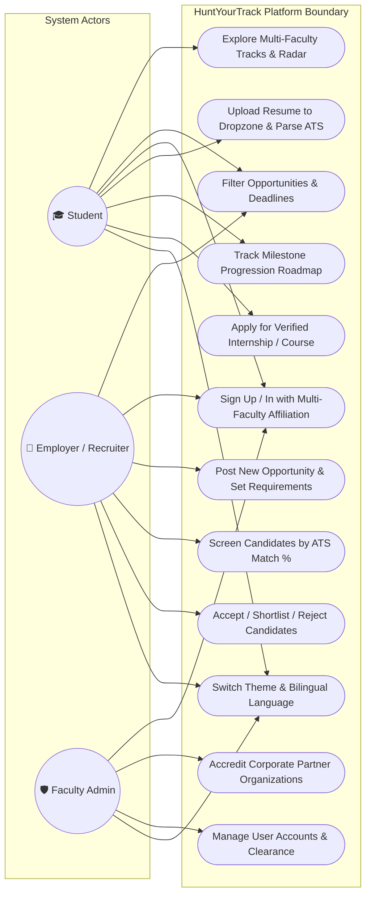
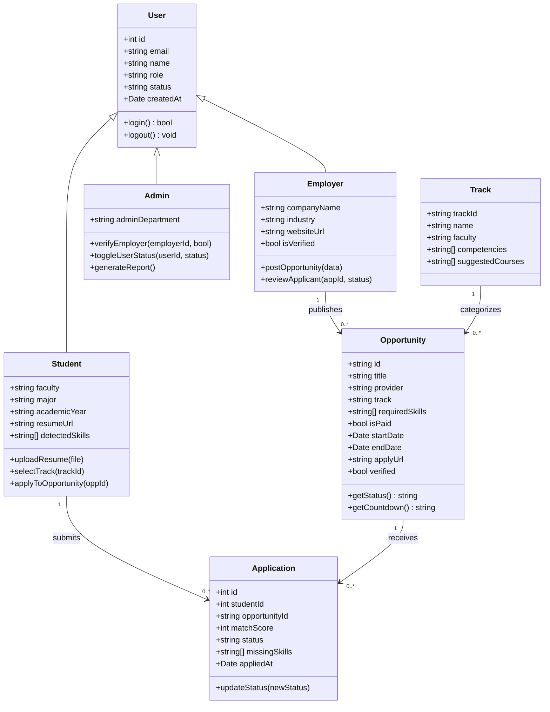
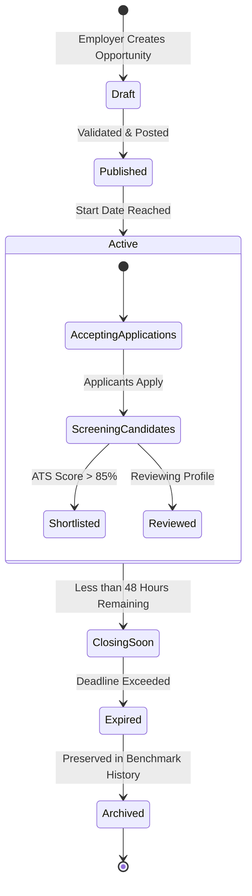
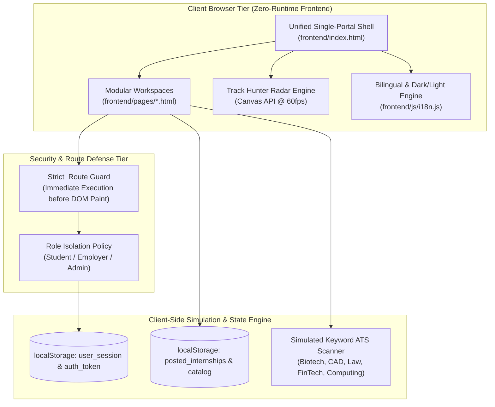
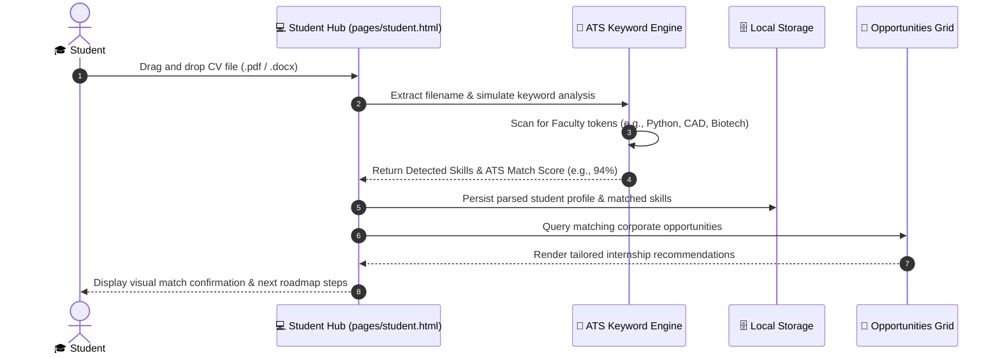

# HuntYourTrack — Software Engineering Designs & UML Models 📐

> **Academic Evaluation Document:** Software Architecture, UML & Visual System Models  
> **Institution:** Faculty of Computers & Information, Damanhour University (CS Department)  
> **Course Supervisor:** Teaching Assistant Eng. Menna  
> **Lead Architect:** Mohamed Yasser Elabsy ([@EngMohamedElabsy](https://github.com/EngMohamedElabsy))  
> **FigJam Collaborative Architecture Board:** [HuntYourTrack FigJam Board](https://www.figma.com/board/LZD5TcXR4hOkupzCyXfzoq)  
> **Figma UI/UX Design System File:** [HuntYourTrack Figma Design File](https://www.figma.com/design/1IRQUalpMLnDSrWdByB0uW)

---

## 1. System Use Case Model

---

## 2. Software Class Diagram (Data & Domain Model)

---

## 3. State Machine Diagram (Opportunity & Student Lifecycle)

---

## 4. Component & Data Flow Architecture

---

## 5. Sequence Diagram: Student Resume Upload & ATS Matching

---

## 6. Diagram Artifacts Repository

All source diagram scripts and vector PDF exports are organized in this directory:
- **Architecture Diagram:** [diagrams/HuntYourTrack_Architecture.puml](diagrams/HuntYourTrack_Architecture.puml) · [PDF Export](pdf_exports/Architecture.pdf)
- **Component Diagram:** [diagrams/HuntYourTrack_ComponentDiagram.puml](diagrams/HuntYourTrack_ComponentDiagram.puml) · [PDF Export](pdf_exports/ComponentDiagram.pdf)
- **Class Model (UML):** [diagrams/HuntYourTrack_UML.puml](diagrams/HuntYourTrack_UML.puml) · [PDF Export](pdf_exports/UML.pdf)
- **Entity Relationship Model (ERD):** [diagrams/HuntYourTrack_ERD.puml](diagrams/HuntYourTrack_ERD.puml) · [PDF Export](pdf_exports/ERD.pdf)
- **Database Schema:** [diagrams/HuntYourTrack_DataBase.puml](diagrams/HuntYourTrack_DataBase.puml) · [PDF Export](pdf_exports/DataBase.pdf)
- **FigJam Interactive Whiteboard:** [HuntYourTrack Live FigJam Board](https://www.figma.com/board/LZD5TcXR4hOkupzCyXfzoq)
