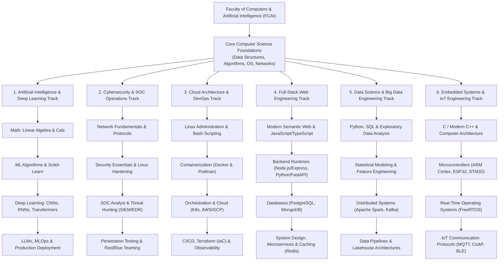

# Faculty of Computers & AI — Canonical Developer Career Roadmaps Tree

This comprehensive roadmap tree serves as the foundational curriculum for HuntYourTrack's developer career engine, modeled after global standards (`roadmap.sh`, ACM IEEE computing curricula, and accredited course repositories like Class Central, Coursera, edX, and MIT OpenCourseWare).

---

## 🌳 Roadmap Family Tree Overview

---

## 1. Track: Artificial Intelligence & Deep Learning

| Phase | Milestone Name | Core Topics | Verified Free Course / Provider (Class Central / MOOC) | Typical Duration | Certificate Option |
| :--- | :--- | :--- | :--- | :--- | :--- |
| **Phase 1** | Mathematical & Python Foundations | Linear Algebra, Multivariable Calculus, Probability, NumPy, Pandas | MIT 18.06SC Linear Algebra / Stanford CS229 Foundations | 6 - 8 Weeks | Free Audit / Verified |
| **Phase 2** | Classical Machine Learning | Supervised vs Unsupervised, Decision Trees, SVM, Gradient Boosting | Stanford Machine Learning Specialization (Andrew Ng) | 8 Weeks | Free Audit |
| **Phase 3** | Deep Learning & Computer Vision | Neural Networks, Backpropagation, CNN Architectures (ResNet, YOLO), PyTorch | DeepLearning.AI / Coursera Deep Learning Specialization | 10 Weeks | Free Audit |
| **Phase 4** | Advanced NLP, Transformers & MLOps | Self-Attention, BERT, GPT, Hugging Face, Model Serving, ONNX | Hugging Face NLP Course / Fast.ai Practical Deep Learning | 8 Weeks | 100% Free Open |

---

## 2. Track: Cybersecurity & SOC Operations

| Phase | Milestone Name | Core Topics | Verified Free Course / Provider (Class Central / MOOC) | Typical Duration | Certificate Option |
| :--- | :--- | :--- | :--- | :--- | :--- |
| **Phase 1** | Networking & System Internals | OSI Model, TCP/IP, DNS, Wireshark, Linux/Windows Administration | Cisco Networking Academy (NDG Linux / CCNA Intro) | 6 Weeks | Free Badge |
| **Phase 2** | Security Principles & Cryptography | Threat Models, Symmetric/Asymmetric Encryption, PKI, OWASP Top 10 | IBM Cybersecurity Analyst Professional Certificate | 8 Weeks | Free Audit |
| **Phase 3** | SOC Analyst & Incident Response | SIEM (Splunk/ELK), Log Analysis, EDR, MITRE ATT&CK Framework | TryHackMe SOC Level 1 / Splunk Fundamentals | 8 Weeks | Free Badge |
| **Phase 4** | Defensive Engineering & Threat Intel | Threat Hunting, Malware Triage, Digital Forensics, Zero Trust | SANS Cyber Aces / Microsoft SC-900 & SC-200 Prep | 6 Weeks | Free Materials |

---

## 3. Track: Cloud Architecture & DevOps

| Phase | Milestone Name | Core Topics | Verified Free Course / Provider (Class Central / MOOC) | Typical Duration | Certificate Option |
| :--- | :--- | :--- | :--- | :--- | :--- |
| **Phase 1** | Linux & Automated Scripting | Bash scripting, Systemd, Process Management, Git & Version Control | Linux Foundation (Introduction to Linux LFS101x) | 6 Weeks | Free Audit |
| **Phase 2** | Containers & Virtualization | Docker Architecture, Multi-Stage Builds, Docker Compose, Podman | Docker Certified Associate Track / freeCodeCamp DevOps | 4 Weeks | 100% Free Open |
| **Phase 3** | Orchestration & Cloud Infrastructure | Kubernetes Architecture, Pods, Deployments, Services, AWS Core | CNCF Kubernetes Fundamentals / Google Cloud Essentials | 8 Weeks | Free Trial / Audit |
| **Phase 4** | Infrastructure as Code (IaC) & Observability | Terraform, GitHub Actions, Prometheus, Grafana, Distributed Tracing | HashiCorp Terraform Associate Prep / GitLab CI Course | 6 Weeks | Free Open Access |

---

## 4. Track: Full-Stack Web Engineering

| Phase | Milestone Name | Core Topics | Verified Free Course / Provider (Class Central / MOOC) | Typical Duration | Certificate Option |
| :--- | :--- | :--- | :--- | :--- | :--- |
| **Phase 1** | Web Standards & Modern JavaScript | Semantic HTML5, CSS Grid/Flexbox, ES6+, Async/Await, Canvas API | Harvard CS50W / MDN Web Docs Curriculum | 8 Weeks | 100% Free Open |
| **Phase 2** | Frontend Architecture & State | Component Lifecycle, React / Vue, State Management, Accessibility | University of Helsinki (Full Stack Open - Part 1-5) | 8 Weeks | Free Verified Certificate |
| **Phase 3** | Robust Backend Runtimes & REST/GraphQL | Node.js, Express, Middleware, JWT Auth, Input Validation, ORMs | Full Stack Open (Part 3-4) / Meta Back-End Developer | 8 Weeks | Free Audit |
| **Phase 4** | Scalable System Design & Deployment | PostgreSQL, Redis Caching, NGINX Reverse Proxy, Dockerizing Apps | Harvard CS50W Capstone / roadmap.sh System Design | 6 Weeks | Free Audit |

---

## 5. ATS Resume Matching Keywords Dictionary

The frontend keyword matcher checks against these domain-specific tokens to automatically identify a student's track:

- **AI & Deep Learning:** `python`, `pytorch`, `tensorflow`, `keras`, `scikit-learn`, `machine learning`, `deep learning`, `cnn`, `yolo`, `transformer`, `nlp`, `pandas`, `numpy`, `opencv`, `huggingface`.
- **Cybersecurity:** `wireshark`, `nmap`, `metasploit`, `siem`, `splunk`, `burp suite`, `owasp`, `penetration testing`, `soc`, `linux hardening`, `cryptography`, `tcp/ip`, `incident response`.
- **Cloud & DevOps:** `docker`, `kubernetes`, `terraform`, `aws`, `gcp`, `azure`, `ci/cd`, `github actions`, `ansible`, `linux`, `bash`, `nginx`, `prometheus`, `grafana`.
- **Full-Stack Web:** `javascript`, `typescript`, `react`, `vue`, `node.js`, `express`, `mongodb`, `postgresql`, `mysql`, `html5`, `css3`, `tailwind`, `rest api`, `graphql`, `redis`.
